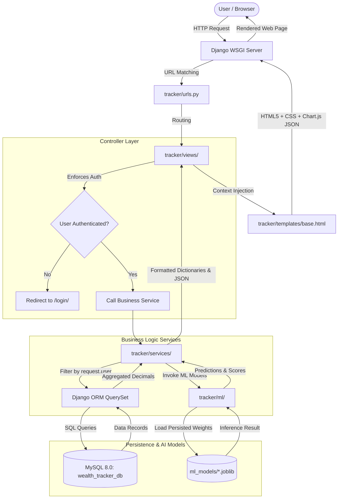

# 02. Architecture & Design: Smart Wealth Tracker and Budget Planner

This document specifies the system architecture, structural layering, separation of concerns, and request-response flow for the application.

---

## 1. Architectural Philosophy
The system follows the **Fat-Service / Thin-View** pattern within Django's Model-View-Template (MVT) architecture. 

### Core Architectural Layers:
1. **Presentation Layer (Frontend):**
   - Django Templates (`tracker/templates/tracker/`) with single root `base.html` inheritance.
   - Design System powered by Bootstrap 5.3 CDN, Bootstrap Icons, and custom CSS design tokens (`static/css/style.css`).
   - Dynamic charts rendered client-side using Chart.js CDN.
   - Lightweight Vanilla JavaScript for DOM manipulation and asynchronous fetch APIs (e.g., live AI category prediction).
2. **Controller Layer (Views):**
   - Thin views located in `tracker/views/` (or modular view files).
   - Responsible strictly for HTTP protocol handling, parameter extraction, form binding, calling services, and returning template renders or JSON responses.
   - Strict access control via `@login_required` / `LoginRequiredMixin`.
3. **Domain & Business Logic Layer (Services):**
   - Pure Python business logic segregated in `tracker/services/`.
   - Handles complex computations: budget consumption aggregation, net worth calculations, velocity forecasting, and alert threshold evaluation.
   - Decoupled from Django HTTP requests for straightforward unit testing.
4. **Machine Learning Layer (`tracker/ml/`):**
   - Independent AI/ML pipeline modules (`categorizer.py`, `forecaster.py`, `anomaly.py`).
   - Pre-trained models serialized with `joblib` in `ml_models/`.
   - Management commands for batch training (`manage.py train_ml_models`).
5. **Persistence Layer (Models & Database):**
   - Django ORM mapping to MySQL 8.0 (`wealth_tracker_db`).
   - Compound database indexes on `(user, date)` and `(user, category)` for fast aggregation queries.

---

## 2. Directory Layout & Module Organization

```
wealth_tracker/
├── venv/                                   # Python 3.13 Virtual Environment
└── wealthtracker/                          # Django Project Root (Contains manage.py)
    ├── manage.py                           # CLI entrypoint
    ├── ml_models/                          # Serialized joblib models
    │   ├── category_model.joblib
    │   └── vectorizer.joblib
    ├── static/                             # Static assets
    │   ├── css/
    │   │   └── style.css                   # Master Design Tokens & Custom CSS
    │   └── js/
    │       └── main.js                     # Global UI helpers & theme toggle
    ├── wealthtracker/                      # Project Config Package
    │   ├── settings.py                     # Project configuration
    │   ├── urls.py                         # Root URL routing
    │   └── wsgi.py                         # WSGI server gateway
    ├── tracker/                            # Main Django Application
    │   ├── models/
    │   │   ├── __init__.py
    │   │   ├── category.py                 # Category entity
    │   │   ├── transaction.py              # Transaction ledger
    │   │   ├── budget.py                   # Budget thresholds
    │   │   ├── goal.py                     # Savings goals & deposits
    │   │   └── wealth.py                   # Assets & Liabilities
    │   ├── views/
    │   │   ├── __init__.py
    │   │   ├── auth_views.py               # Signup, login, logout, profile
    │   │   ├── dashboard_views.py          # Dashboard & KPI summaries
    │   │   ├── transaction_views.py        # Transaction CRUD & CSV export
    │   │   ├── budget_views.py             # Budget planning & alerts
    │   │   ├── goal_views.py               # Savings milestones & deposits
    │   │   ├── wealth_views.py             # Net worth, assets, liabilities
    │   │   ├── report_views.py             # Monthly & annual reports
    │   │   └── ai_views.py                 # AI insights & live predict API
    │   ├── services/
    │   │   ├── dashboard_service.py        # KPI calculations & chart series
    │   │   ├── budget_service.py           # Spending vs limit evaluations
    │   │   ├── goal_service.py             # Goal velocity & countdowns
    │   │   └── wealth_service.py           # Net worth aggregator
    │   ├── ml/
    │   │   ├── data/
    │   │   │   └── seed_transactions.csv   # 300+ Indian merchant descriptions
    │   │   ├── categorizer.py              # Naive Bayes / Logistic Regression
    │   │   ├── forecaster.py               # Linear Regression time series
    │   │   └── anomaly.py                  # Isolation Forest / Z-score detector
    │   ├── forms.py                        # Django ModelForms with styled widgets
    │   ├── signals.py                      # Post-save user signal for default categories
    │   ├── templatetags/
    │   │   └── currency_filters.py         # Indian currency formatting (₹)
    │   ├── management/
    │   │   └── commands/
    │   │       ├── train_ml_models.py      # Retrain and persist models
    │   │       └── seed_demo_data.py       # Seed 6 months of test records
    │   └── templates/tracker/              # Presentation templates
    │       ├── base.html                   # Master layout with sidebar & navbar
    │       ├── landing.html                # Public landing page
    │       ├── login.html                  # Dual-panel login
    │       ├── signup.html                 # Dual-panel register
    │       ├── dashboard.html              # Main dashboard with Chart.js
    │       ├── transaction_list.html       # Ledger table with filters
    │       ├── add_transaction.html        # Form with live AI auto-tag
    │       ├── budget_list.html            # Budgets with progress bars
    │       ├── add_budget.html             # Budget creation form
    │       ├── savings_goal_list.html      # Goals with progress rings
    │       ├── add_savings_goal.html       # Goal creation form
    │       ├── add_savings_contribution.html # Deposit form
    │       ├── net_worth.html              # Assets & liabilities tracker
    │       ├── reports.html                # Monthly/annual financial reports
    │       └── ai_insights.html            # ML forecasting & sandbox
    └── docs/                               # Project Documentation
```

---

## 3. Request-Response Lifecycle Diagram



---

## 4. Multi-Tenant Data Scoping Pattern
To guarantee 100% data privacy and security between users:

```python
# Standard QuerySet pattern across all services:
def get_user_transactions(user, start_date=None, end_date=None):
    qs = Transaction.objects.filter(user=user)
    if start_date and end_date:
        qs = qs.filter(date__range=[start_date, end_date])
    return qs.order_by('-date')
```

Under no circumstances is a global `Transaction.objects.all()` allowed without scoping by `user`.
