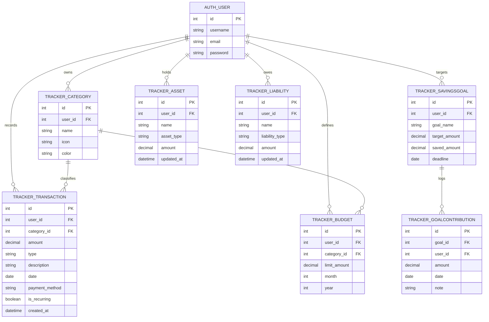

# 03. Database Schema: Smart Wealth Tracker and Budget Planner

This document provides the exhaustive specification for all database entities, columns, relationships, constraints, indexes, and an Entity-Relationship (ER) diagram.

---

## 1. Database Connection & Engine
- **Engine:** MySQL 8.0.40 via `mysqlclient`
- **Database Name:** `wealth_tracker_db`
- **Character Set:** `utf8mb4` (supports unicode merchant names & emoji icons)
- **Collation:** `utf8mb4_unicode_ci`

---

## 2. Entity-Relationship (ER) Diagram

---

## 3. Table Definitions & Column Specifications

### 3.1 `tracker_category`
Represents spending and income classifications per user.
| Column | Type | Constraints | Description |
| :--- | :--- | :--- | :--- |
| `id` | BigAutoField | Primary Key | Unique Category ID |
| `user_id` | Integer | Foreign Key (`auth_user.id`), `ON DELETE CASCADE` | Owner user |
| `name` | Varchar(100) | Not Null | Category label (e.g., Food, Travel) |
| `icon` | Varchar(50) | Default: `'bi-tag'` | Bootstrap Icons class identifier |
| `color` | Varchar(20) | Default: `'#4f46e5'` | Hex color code for chart rendering |
- **Constraints:** `unique_together = ('user', 'name')` to avoid duplicate categories per user.

---

### 3.2 `tracker_transaction`
Represents monetary debits and credits recorded by the user.
| Column | Type | Constraints | Description |
| :--- | :--- | :--- | :--- |
| `id` | BigAutoField | Primary Key | Unique Transaction ID |
| `user_id` | Integer | Foreign Key (`auth_user.id`), `ON DELETE CASCADE` | Transaction owner |
| `category_id`| Integer | Foreign Key (`tracker_category.id`), `ON DELETE SET_NULL`, Nullable | Associated category |
| `amount` | Decimal(10, 2) | Check: `amount > 0` | Currency value in ₹ |
| `type` | Varchar(10) | Choices: `('income', 'expense')` | Cash flow direction |
| `description`| Varchar(255) | Blank=True | Transaction memo / merchant name |
| `date` | Date | Not Null | Date of transaction |
| `payment_method`| Varchar(50)| Blank=True, Default: `'UPI'` | Cash, UPI, Card, Net Banking |
| `is_recurring` | Boolean | Default: `False` | Flag for monthly recurring bills |
| `created_at` | DateTime | Auto_now_add=True | Audit timestamp |
- **Indexes:**
  - `INDEX idx_user_date (user_id, date)`: Accelerates dashboard time filtering and 6-month chart aggregations.
  - `INDEX idx_user_cat (user_id, category_id)`: Accelerates category donut chart summaries.

---

### 3.3 `tracker_budget`
Defines monthly spending caps per category.
| Column | Type | Constraints | Description |
| :--- | :--- | :--- | :--- |
| `id` | BigAutoField | Primary Key | Unique Budget ID |
| `user_id` | Integer | Foreign Key (`auth_user.id`), `ON DELETE CASCADE` | Owner user |
| `category_id`| Integer | Foreign Key (`tracker_category.id`), `ON DELETE CASCADE` | Targeted category |
| `limit_amount`| Decimal(10, 2)| Not Null, `limit_amount > 0` | Ceiling threshold in ₹ |
| `month` | Integer | Range: 1–12 | Calendar month |
| `year` | Integer | e.g. 2026 | Calendar year |
- **Constraints:** `unique_together = ('user', 'category', 'month', 'year')`.

---

### 3.4 `tracker_savingsgoal`
Stores target savings milestones with deadlines.
| Column | Type | Constraints | Description |
| :--- | :--- | :--- | :--- |
| `id` | BigAutoField | Primary Key | Unique Goal ID |
| `user_id` | Integer | Foreign Key (`auth_user.id`), `ON DELETE CASCADE` | Goal owner |
| `goal_name` | Varchar(100) | Not Null | Name (e.g. Emergency Fund) |
| `target_amount`| Decimal(10, 2)| Not Null | Target financial milestone in ₹ |
| `saved_amount` | Decimal(10, 2)| Default: `0.00` | Current accumulated sum in ₹ |
| `deadline` | Date | Not Null | Target completion date |

---

### 3.5 `tracker_goalcontribution`
Maintains an audit ledger of incremental deposits into a savings goal.
| Column | Type | Constraints | Description |
| :--- | :--- | :--- | :--- |
| `id` | BigAutoField | Primary Key | Unique Contribution ID |
| `goal_id` | Integer | Foreign Key (`tracker_savingsgoal.id`), `ON DELETE CASCADE` | Parent goal |
| `user_id` | Integer | Foreign Key (`auth_user.id`), `ON DELETE CASCADE` | Contributor user |
| `amount` | Decimal(10, 2) | Check: `amount > 0` | Deposited sum in ₹ |
| `date` | Date | Not Null | Deposit date |
| `note` | Varchar(200) | Blank=True | Optional contribution note |

---

### 3.6 `tracker_asset` & `tracker_liability` (Net Worth Module)
Tracks user capital holdings and financial obligations to calculate overall Net Worth.

**`tracker_asset`:**
- `id` (BigAutoField, PK)
- `user_id` (FK to `auth_user.id`)
- `name` (Varchar(100), e.g. HDFC Savings, Zerodha Equities, Gold)
- `asset_type` (Varchar(50), choices: Cash, Bank, Investment, Real Estate, Gold, Other)
- `amount` (Decimal(12, 2))
- `updated_at` (DateTime, Auto_now=True)

**`tracker_liability`:**
- `id` (BigAutoField, PK)
- `user_id` (FK to `auth_user.id`)
- `name` (Varchar(100), e.g. Home Loan, Credit Card Bill, Personal Loan)
- `liability_type` (Varchar(50), choices: Mortgage, Credit Card, Auto Loan, Student Loan, Other)
- `amount` (Decimal(12, 2))
- `updated_at` (DateTime, Auto_now=True)
